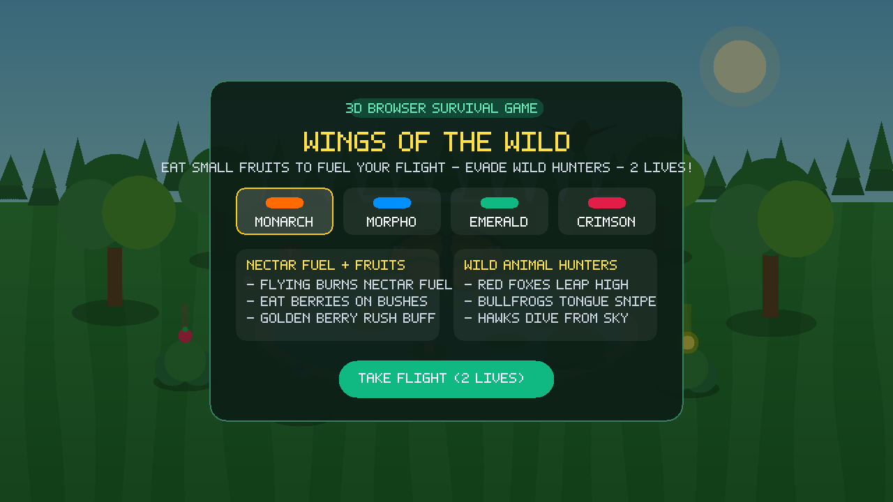
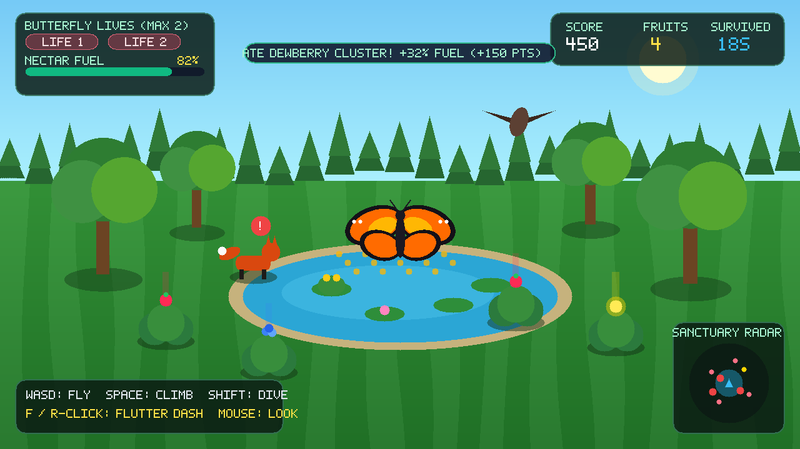
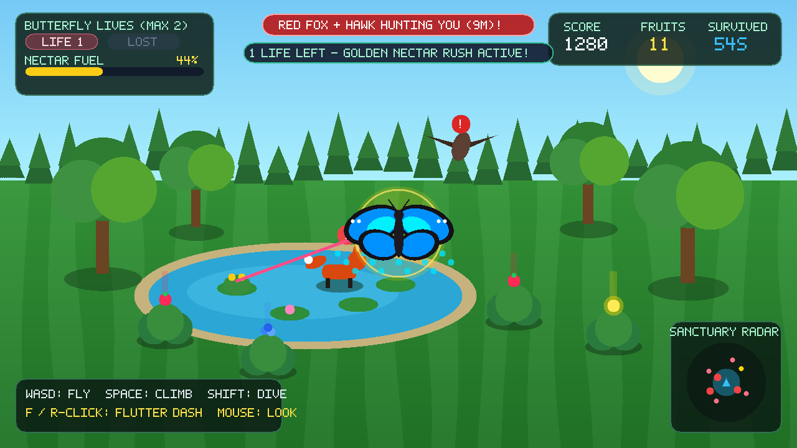

# 🦋 Wings of the Wild — 3D Butterfly Survival

> **Fly across a sun-dappled 3D woodland sanctuary, fuel your wings by eating small wild fruits, and evade hungry predators hunting you from land, pond, and sky — with only 2 lives!**

🌐 **Play Live on Netlify:** **[https://butterfly-survival-3d.netlify.app](https://butterfly-survival-3d.netlify.app)**
🌐 **GitHub Pages Mirror:** **[https://muneebbeenam.github.io/Butterfly-survival-3d/](https://muneebbeenam.github.io/Butterfly-survival-3d/)**



---

## 🎮 Gameplay Overview

**Wings of the Wild** is a fast-paced 3D third-person survival browser game built with **Three.js** and procedural **Web Audio API** sound synthesis.

- **🦋 3D Articulated Butterfly Flight:** Choose from 4 vibrant procedural wing patterns (**Monarch Blaze**, **Blue Morpho**, **Emerald Swallowtail**, and **Crimson Empress**). Bank, climb, dive, and trigger an evasive **Flutter Dash** with shimmering pollen trails.
- **🍓 Nectar Fuel & Small Fruits:** Flying and climbing continuously burn **Nectar Fuel (0–100%)**. Swoop down onto berry bushes, pond lily pads, mossy boulders, and tree branches to eat small fruits before your fuel runs dry!
- **❤️ Strictly 2 Lives:** Getting caught by a wild predator—or starving at `0%` fuel for too long—costs **1 Life**. Losing your first life triggers a temporary **Respawn Shield** so you can recover; losing your second life ends the run.
- **🧭 Live 3D Sanctuary Radar:** Track nearby fruits, golden berries, and actively hunting predators in real time on the bottom-right minimap.

---

## 📸 Screenshots

### Woodland Flight & Fruit Foraging


### Predator Chase & Golden Nectar Rush (1 Life Remaining!)


---

## 🦊 Wild Animal Predators

| Predator | Habitat | Hunting Behavior |
| :--- | :--- | :--- |
| **🦊 Red Fox** | Meadow Hills | Patrols the grass; locks on (`!`) when you fly low, sprints underneath you, crouches, and leaps high into mid-air. |
| **🐆 Wild Lynx** | Boulders & Bushes | Stalks berry patches and launches fast diagonal pounces when you swoop down for fruit. |
| **🐸 Giant Bullfrog** | Central Crystal Pond | Lurks on lily pads, aims with a red telegraph laser, and fires a fast long-range sticky tongue strike. |
| **🦅 Peregrine Hawk** | High Sky Canopy | Circles above the trees and screeches before executing a high-speed diving stoop if you linger in the open sky. |

---

## 🍓 Small Fruits & Buffs

| Fruit | Location | Effect |
| :--- | :--- | :--- |
| **🍓 Wild Berry** | Meadow Berry Bushes | `+25% Nectar Fuel`, `+100 Score` |
| **🫐 Dewberry Cluster** | Pond Lily Pads & Rocks | `+32% Nectar Fuel`, `+150 Score` |
| **🌟 Golden Sun-Berry** | Perilous Rocks & Tree Branches | `+55% Nectar Fuel`, `+300 Score` + **5.5s Golden Nectar Rush** (unlimited dash & magnetic fruit pull) |

---

## 🕹️ Controls

| Key / Input | Action |
| :--- | :--- |
| `W` `A` `S` `D` or `Arrow Keys` | Fly & bank horizontally |
| `Mouse Move` or `Q` / `E` | Orbit camera view (`Mouse Wheel` to zoom) |
| `Space` | Flap upward / climb higher |
| `Shift` or `C` | Swoop / dive down toward bushes & pond |
| `F` or `Right-Click` | **Flutter Dash** (evasive burst of speed) |
| `P` | Pause / Resume game |

---

## 🚀 Run Locally

### Option 1: Zero-Build Direct Open
Simply open `index.html` in any modern browser—Three.js is bundled in `vendor/three.min.js` with a CDN fallback.

### Option 2: Local Node HTTP Server
```bash
npm install
npm start
```
Then visit **`http://localhost:3000`** in your browser.

---

## 🌐 Deploying Live (GitHub Pages)

Because this repository includes `index.html` at the root and bundles `vendor/three.min.js` without requiring a build step, you can make it live in seconds:

1. Push this repository to GitHub.
2. Go to **Settings → Pages** in your GitHub repository.
3. Under **Build and deployment**, set **Source** to **Deploy from a branch**.
4. Select branch **`main`** and folder **`/ (root)`**, then click **Save**.
5. Your game will be live at `https://<your-username>.github.io/<repo-name>/`!

---

## 📂 Project Structure

```text
├── index.html          # Main entry point, HUD overlay, and start/game-over modals
├── style.css           # Glassmorphic woodland theme, animations, and responsive HUD styles
├── server.js           # Zero-dependency Node.js static HTTP server
├── vendor/
│   └── three.min.js    # Bundled Three.js r160 runtime for instant offline/online play
├── screenshots/        # In-game WebGL screenshots
└── js/
    ├── audio.js        # Procedural Web Audio API sound effects & forest bird ambience
    ├── particles.js    # 3D wing shimmer trails, fruit bursts, and floating meadow pollen
    ├── world.js        # 3D terrain, crystal pond, lily pads, trees, bushes, rocks & flowers
    ├── butterfly.js    # 3D articulated butterfly model, procedural wing canvas textures & flight physics
    ├── fruits.js       # 3D small fruits manager, glowing beacons & magnetic pickup
    ├── predators.js    # 3D wild animal models (Fox, Lynx, Bullfrog, Hawk) & hunting AI state machines
    └── game.js         # Main loop, 3rd-person orbit camera, 2-lives system & live radar minimap
```
